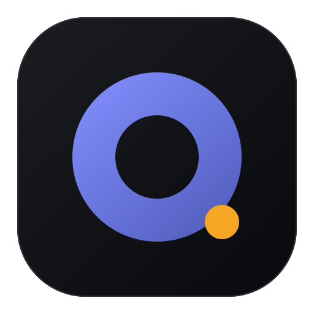
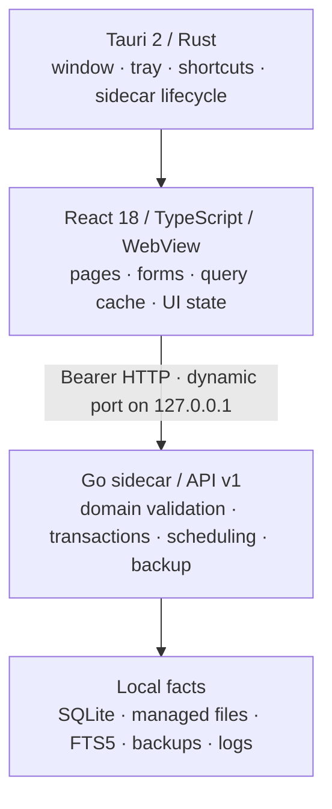

<div align="center">
  

  <h1>opc-workspace</h1>

  <p><strong>A local-first desktop workspace for one-person companies</strong></p>
  <p>Manage tasks, projects, clients, an inbox, focus time and local business data in one desktop app that works offline.</p>

  <p>
    <a href="./README.md">简体中文</a>
    ·
    <a href="./README.en.md">English</a>
    ·
    <a href="./docs/README.md">Documentation</a>
    ·
    <a href="./docs/opc-workspace-PRD.md">PRD</a>
    ·
    <a href="./docs/changelog.md">Changelog</a>
  </p>

  <p>
    
    
    
    
    
    
  </p>
</div>

> [!IMPORTANT]
> The project is under active development and has no stable release yet. Windows x64 can build unsigned installers for local testing; code signing, installation acceptance and macOS / Linux support are not done. The current app and database schema versions are stated at the top of the [PRD](./docs/opc-workspace-PRD.md), and the status of each module in the [module overview](./docs/modules/README.md). The documentation is written in Chinese.

## Contents

- [About](#about)
- [Features](#features)
- [Project status](#project-status)
- [Getting started](#getting-started)
- [Build and checks](#build-and-checks)
- [Architecture](#architecture)
- [Repository layout](#repository-layout)
- [Data and security](#data-and-security)
- [Documentation](#documentation)
- [Contributing](#contributing)
- [License](#license)

## About

Independent developers, freelancers, creators and consultants keep switching between a task tool, project spreadsheets, client notes, a timer and a content calendar. opc-workspace brings these everyday workflows into one lightweight desktop app and keeps the business data on the user's own computer. `OPC` stands for **one-person company**: the project targets a business run by one person, not a scaled-down team tool.

Design principles:

- **Local first.** Core features work offline. Business facts live in a local SQLite database and a managed file directory. There is no cloud sync and no account system.
- **One set of facts.** Tasks, projects, clients, the inbox, focus sessions and reminders work on the same data.
- **Traceable.** Assignments, status changes, submitted outputs, reviews and rework keep an explicit record.
- **Human in the loop.** The AI assistant and local agents can only propose. Writing business data, starting a run and reading files each need the user's confirmation.
- **Nothing else to install.** The installer bundles the frontend and the backend service; end users do not need Docker, Node.js, Go or Rust.

## Features

| Area                 | What it does                                                                                                             |
| -------------------- | ------------------------------------------------------------------------------------------------------------------------ |
| Today                | Overdue, today, later this week and unscheduled tasks in one view, with scheduling and ordering                          |
| Tasks and review     | Six-state task lifecycle, subtasks, assignments, output submission, manual review and rework                             |
| Projects and clients | Project progress, notes and attachments; client records, activities, follow-up plans                                     |
| Inbox and reminders  | Local intake, snooze, splitting an item into tasks, progress, recurring reminders                                        |
| Focus and time       | Resumable focus sessions bound to tasks, history, statistics by project and tag                                          |
| Content and roadmap  | Content scheduling with preparation tasks, quarterly milestones, due items projected into the inbox                      |
| Finance and invoices | Local ledger, invoice states with payment posting, PDF generation, due reminders                                         |
| Search and commands  | Local search across tasks, projects, clients and the inbox; command palette and global shortcuts                         |
| Data management      | Versioned migrations, consistent backup and restore, business data import/export (JSON / ZIP), diagnostics               |
| Local automation     | A fixed set of built-in presets only; no arbitrary shell, SQL, HTTP or outbound actions                                  |
| AI assistant         | Remote or local model providers, streaming chat, citations from a local knowledge base, proposals that need confirmation |
| Local agents         | A controlled built-in runner on Windows: runs per task and registers outputs, which still need review                    |

Flows, APIs and acceptance criteria of each module are in the [module documentation](./docs/modules/README.md).

## Project status

- **Usable foundation.** The local loops for tasks, projects, clients, inbox, focus, reminders, search, backup/restore and import/export are implemented and covered by automated tests.
- **Partly done.** Finance and invoices, the content calendar, the roadmap, local automation, the AI assistant, the local knowledge base and local agents have their main slices delivered; scope and limits are in the module documents.
- **Not done.** A stable release, signed installers, macOS / Linux builds and acceptance, cloud sync, multi-user accounts and remote messaging.
- **How it is verified.** The default gates are deterministic automated checks. Real model quality and installation or native-window behaviour on real devices are manual acceptance items, listed in [PRD 10.5](./docs/opc-workspace-PRD.md#105-当前验证矩阵); they have not been carried out yet.

What each slice delivered is recorded in the [changelog](./docs/changelog.md). For what is implemented now, the code, the tests and the module documents are authoritative.

## Getting started

### Requirements

| Dependency          | Version                                               |
| ------------------- | ----------------------------------------------------- |
| Node.js             | 20.19–26                                              |
| pnpm                | 10+ (the repository pins `pnpm@11.21.0`)              |
| Go                  | 1.24+                                                 |
| Rust                | 1.85+, installed with rustup                          |
| Tauri prerequisites | The Tauri 2 prerequisites for Windows, macOS or Linux |

Windows desktop builds also need the WebView2 Runtime (122.0.2365.46 or newer), Visual Studio C++ Build Tools and the Windows SDK. Local development does not use Docker.

Two environment requirements that are easy to miss:

- **Line endings.** `.gitattributes` keeps the working tree at LF, and Prettier, gofmt and rustfmt check for LF. An older working tree checked out as CRLF fails `pnpm format:check` everywhere; check it out again.
- **Temp directory.** The Go and Rust tests for managed directories reject paths that pass through a junction or symbolic link. If `TEMP` / `TMP` point through one, set them to a real directory first; `pnpm check:temp` reports this case.

### Install and run

```powershell
# Install dependencies
pnpm install
go -C services/sidecar mod download

# Start the desktop development environment (Go sidecar + Vite + Tauri)
pnpm dev

# Start only the sidecar and the browser frontend
pnpm dev:web
```

Development data is stored in `.local/dev-data/`, which Git ignores. It never touches the installed app's data directory, and no demo data is generated. Set `OPC_DEV_DATA_DIR` to use another directory. Desktop-only features such as the embedded browser, the file workspace and the terminal are available only in the app opened by `pnpm dev`.

## Build and checks

```powershell
# Build the sidecar, the web frontend and the desktop installers for this platform
pnpm build

# Full gate
pnpm check

# Source gate that does not need the Rust toolchain
pnpm check:source

# List the checks suggested for the unpushed changes (suggests only)
pnpm check:impact
```

| Command              | What it runs                                                                              |
| -------------------- | ----------------------------------------------------------------------------------------- |
| `pnpm format:check`  | Prettier, gofmt and rustfmt                                                               |
| `pnpm check:docs`    | Local Markdown links and heading anchors                                                  |
| `pnpm check:scripts` | Unit tests of the gate scripts                                                            |
| `pnpm check:web`     | TypeScript type check, ESLint, Vitest, production build                                   |
| `pnpm check:go`      | Temp directory preflight, gofmt, `go test`, `go vet`, sidecar build                       |
| `pnpm check:rust`    | Temp directory preflight, build script tests, `cargo check`, `cargo test` for both crates |

`pnpm check:source` runs the first five and `pnpm check` adds `check:rust`. None of them calls a real model, needs a key or uses the network.

The workflow [`.github/workflows/check.yml`](./.github/workflows/check.yml) runs the same `pnpm check` on a GitHub Windows runner for pushes to `main` and for every pull request.

On Windows x64, `pnpm build` writes NSIS and MSI installers under `apps/desktop/src-tauri/target/x86_64-pc-windows-msvc/release/bundle/`. Both are unsigned test packages and currently ship Simplified Chinese only.

## Architecture



The desktop shell starts and supervises the bundled Go sidecar. The sidecar listens on the loopback address only and uses a new random session token on every start; the React UI reaches local business features through the versioned `/api/v1`. The database, attachments, backups and logs live in the application data directory assigned by the operating system, apart from the installation directory.

Module relationships, event flows and security boundaries are described in the [functional architecture](./docs/functional-architecture.md); significant decisions are recorded in [`docs/adr/`](./docs/adr/).

## Repository layout

```text
apps/
  web/                    React 18 + TypeScript + Vite frontend
  desktop/                Tauri 2 desktop shell (Rust)
  file-security-helper/   Helper for single-file operations on Windows (Rust)
services/
  sidecar/                Go HTTP API, SQLite migrations, managed files and tests
scripts/                  Development orchestration, build and gate scripts
docs/                     PRD, architecture, ADRs, module documents and changelog
```

## Data and security

- Business data stays on the local machine. The app does not depend on any cloud service.
- With a remote model provider, only the content the user authorises for that message is sent to the provider; with a local model nothing leaves the machine.
- Business writes, file reads and run starts by the AI or an agent each need a confirmation. No workspace permission is granted by default.
- The database changes through versioned migrations; before a destructive migration a rollback backup is created and verified automatically.

Backup, restore and import/export behaviour and limits are described in the [data management module](./docs/modules/data-management.md).

If you find a security issue, please do not disclose the details in a public issue; contact the repository owner privately through GitHub first.

## Documentation

- [Documentation hub](./docs/README.md): reading order, sources of truth and module status.
- [Product requirements (PRD)](./docs/opc-workspace-PRD.md): scope, version boundaries and the verification matrix.
- [Functional architecture](./docs/functional-architecture.md): module relationships, event flows and ownership of facts.
- [Module documentation](./docs/modules/README.md): flows, APIs, states and acceptance criteria per module.
- [Changelog](./docs/changelog.md): what each version and slice delivered.
- [Sidecar developer notes](./services/sidecar/README.md): local API, data and server-side verification.

The documents distinguish "implemented", "partly done", "page skeleton" and "planned". Where they differ, code and tests are authoritative for what is implemented, and the PRD for product scope.

## Contributing

Issues and suggestions are welcome through [GitHub Issues](https://github.com/DingxinTao0417/opc-workspace/issues). Before opening a pull request:

1. For larger changes, open an issue first to agree on scope, and read the version boundaries in the [PRD](./docs/opc-workspace-PRD.md).
2. A change to behaviour, data structures or APIs updates the matching module document in the same pull request and adds one entry to the [changelog](./docs/changelog.md).
3. Run `pnpm check` (or use `pnpm check:impact` to pick the affected checks) and make sure it passes.
4. New tests must not depend on a real model, a key or the network.

## License

The repository does not contain a `LICENSE` file yet. Until a license is chosen, visible source code does not grant permission to copy, modify, redistribute or use it commercially.
