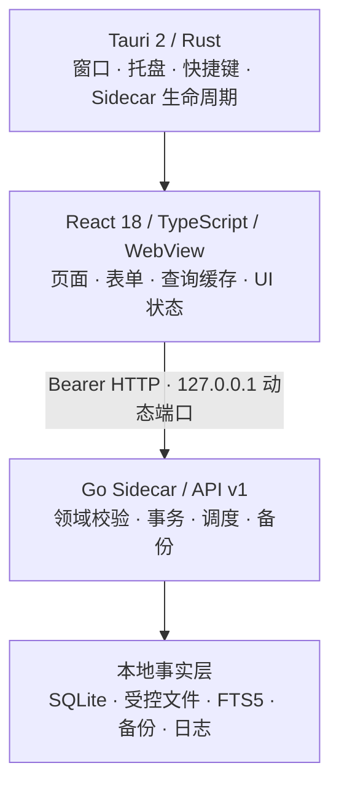

<div align="center">
  

  <h1>opc-workspace</h1>

  <p><strong>面向一人公司的本地优先桌面工作台</strong></p>
  <p>在一个离线可用的桌面应用里管理任务、项目、客户、收件箱、专注时间与本地业务数据。</p>

  <p>
    <a href="./README.md">简体中文</a>
    ·
    <a href="./README.en.md">English</a>
    ·
    <a href="./docs/README.md">文档中心</a>
    ·
    <a href="./docs/opc-workspace-PRD.md">产品需求文档</a>
    ·
    <a href="./docs/changelog.md">变更记录</a>
  </p>

  <p>
    
    
    
    
    
    
  </p>
</div>

> [!IMPORTANT]
> 项目处于积极开发阶段，尚未发布正式版本。Windows x64 可以构建未签名的本地测试安装包；代码签名、安装验收和 macOS / Linux 支持尚未完成。当前版本号与数据库 schema 版本见 [PRD](./docs/opc-workspace-PRD.md) 文首，各模块的完成度见[模块状态总览](./docs/modules/README.md)。

## 目录

- [项目简介](#项目简介)
- [功能概览](#功能概览)
- [项目状态](#项目状态)
- [快速开始](#快速开始)
- [构建与检查](#构建与检查)
- [技术架构](#技术架构)
- [仓库结构](#仓库结构)
- [数据与安全](#数据与安全)
- [文档](#文档)
- [参与贡献](#参与贡献)
- [许可证](#许可证)

## 项目简介

独立开发者、自由职业者、内容创作者和咨询顾问，常常要在任务工具、项目表格、客户资料、计时器和内容日历之间来回切换。opc-workspace 把这些高频工作流收进一个轻量的桌面应用，并让业务数据默认留在用户自己的电脑上。`OPC` 取自 **one-person company**：项目面向一人经营的场景，而不是缩小版的多人协作软件。

设计原则：

- **本地优先**：核心能力离线可用，业务事实保存在本机 SQLite 与受控文件目录中，没有云同步和账号体系。
- **同一套事实**：任务、项目、客户、收件箱、专注与提醒围绕同一份业务数据协作，而不是各自为政的小工具。
- **可追溯**：分派、状态变化、产出提交、验收和返工都保留明确记录。
- **人在回路**：AI 助手与本地 Agent 只能提出建议，写入业务数据、启动执行、读取文件都需要用户逐项确认。
- **安装即用**：安装包内置前端与后端服务，最终用户不需要 Docker、Node.js、Go 或 Rust。

## 功能概览

| 模块         | 能力                                                                          |
| ------------ | ----------------------------------------------------------------------------- |
| 今日工作台   | 聚合逾期、当天、本周稍后和未排期任务，支持排期、排序与快捷执行                |
| 任务与验收   | 六状态任务生命周期、父子任务、责任分派、产出提交、人工验收与返工              |
| 项目与客户   | 项目进度、笔记、附件，客户资料、活动记录、回访计划与关联视图                  |
| 收件箱与提醒 | 本地事项受理、稍后处理、拆分为任务、完成进度与重复提醒                        |
| 专注与工时   | 可恢复的专注会话、任务绑定、历史记录与按项目、标签的统计                      |
| 内容与路线图 | 内容排期与准备任务、季度里程碑，以及到期事项向收件箱的投影                    |
| 收支与发票   | 本地账本、发票状态与回款入账、PDF 生成与到期提醒                              |
| 搜索与命令   | 跨任务、项目、客户与收件箱的本地搜索，命令面板与全局快捷键                    |
| 数据管理     | 版本化迁移、一致性备份与恢复、业务数据 JSON / ZIP 导入导出、诊断              |
| 本地自动化   | 仅开放代码内置的受限预设，不提供任意 Shell、SQL、HTTP 或外发能力              |
| AI 助手      | 远程或本地模型 Provider、流式对话、本地知识库引用、需人工确认的工作台操作建议 |
| 本地 Agent   | Windows 内置受控执行器：按任务执行、产出登记，结果仍需人工验收                |

各模块的流程、接口和验收标准见[模块文档](./docs/modules/README.md)。

## 项目状态

- **已可使用的基座**：任务、项目、客户、收件箱、专注、提醒、搜索、备份恢复与导入导出的本地闭环已经实现，并由自动化测试覆盖。
- **部分完成**：收支与发票、内容日历、路线图、本地自动化、AI 助手、本地知识库与本地 Agent 已交付主要纵切，范围和限制见各自的模块文档。
- **尚未完成**：正式发布、安装包签名、macOS / Linux 构建与验收、云同步、多人账号与远程消息发送。
- **验证口径**：仓库的默认门禁是确定性的自动化检查。真实模型质量、真实设备上的安装与原生窗口行为属于人工验收，清单与执行记录见 [PRD 10.5](./docs/opc-workspace-PRD.md#105-当前验证矩阵)，目前尚未执行。

每个切片交付了什么记录在[变更记录](./docs/changelog.md)。判断“现在实现了什么”时，以代码、测试和模块文档为准。

## 快速开始

### 环境要求

| 依赖           | 版本                                                      |
| -------------- | --------------------------------------------------------- |
| Node.js        | 20.19–26                                                  |
| pnpm           | 10+（仓库锁定 `pnpm@11.21.0`）                            |
| Go             | 1.24+                                                     |
| Rust           | 1.85+，通过 rustup 安装                                   |
| Tauri 系统依赖 | 对应 Windows、macOS 或 Linux 平台的 Tauri 2 prerequisites |

Windows 桌面构建还需要 WebView2 Runtime（122.0.2365.46 或更新）、Visual Studio C++ Build Tools 与 Windows SDK。本地开发与运行不使用 Docker。

两条容易踩到的环境前提：

- **换行符**：仓库通过 `.gitattributes` 统一为 LF，Prettier、gofmt 与 rustfmt 都按 LF 校验。以 CRLF 检出的旧工作区会让 `pnpm format:check` 整体失败，重新检出即可。
- **临时目录**：Go 与 Rust 的安全目录测试拒绝经过目录联接（junction）或符号链接的路径。如果 `TEMP` / `TMP` 被重定向到这类路径，请先把它们指向真实目录；`pnpm check:temp` 会直接指出这种情况。

### 安装与启动

```powershell
# 安装依赖
pnpm install
go -C services/sidecar mod download

# 启动桌面开发环境（Go Sidecar + Vite + Tauri）
pnpm dev

# 只启动 Sidecar 与浏览器版前端
pnpm dev:web
```

开发数据保存在已被 Git 忽略的 `.local/dev-data/`，不会写入正式应用数据目录，也不会自动生成演示数据；需要换一个数据目录时设置环境变量 `OPC_DEV_DATA_DIR`。内嵌浏览器、文件工作区和终端等桌面能力只在 `pnpm dev` 打开的桌面版中可用，`pnpm dev:web` 不模拟它们。

## 构建与检查

```powershell
# 构建当前平台的 Sidecar、Web 前端和桌面安装包
pnpm build

# 完整门禁
pnpm check

# 不依赖 Rust 工具链的源码门禁
pnpm check:source

# 按未推送的改动列出建议运行的检查（只建议，不执行）
pnpm check:impact
```

| 命令                 | 内容                                                                             |
| -------------------- | -------------------------------------------------------------------------------- |
| `pnpm format:check`  | Prettier、gofmt、rustfmt 格式检查                                                |
| `pnpm check:docs`    | Markdown 本地链接与标题锚点                                                      |
| `pnpm check:scripts` | 门禁脚本自身的单元测试                                                           |
| `pnpm check:web`     | TypeScript 类型检查、ESLint、Vitest、生产构建                                    |
| `pnpm check:go`      | 临时目录预检、gofmt、`go test`、`go vet`、Sidecar 构建                           |
| `pnpm check:rust`    | 临时目录预检、桌面构建脚本测试、`cargo check`、桌面与文件辅助程序的 `cargo test` |

`pnpm check:source` 依次执行前五项，`pnpm check` 再加上 `check:rust`。这些门禁不调用真实模型、不需要密钥，也不依赖公网。

持续集成工作流 [`.github/workflows/check.yml`](./.github/workflows/check.yml) 在 GitHub 的 Windows runner 上对 `main` 的推送和所有 Pull Request 运行同一条 `pnpm check`。

Windows x64 的 `pnpm build` 会在 `apps/desktop/src-tauri/target/x86_64-pc-windows-msvc/release/bundle/` 下生成 NSIS 与 MSI 安装包。两者都是未签名的本地测试包，目前只内置简体中文。

## 技术架构



桌面壳负责启动并监管内置的 Go Sidecar。Sidecar 只监听回环地址，每次启动使用新的随机会话令牌；React 界面通过版本化的 `/api/v1` 访问本地业务能力。数据库、附件、备份和日志保存在操作系统分配的应用数据目录中，与安装目录分离。

模块关系、事件流与安全边界见[整体功能架构](./docs/functional-architecture.md)，重要决策记录在 [`docs/adr/`](./docs/adr/)。

## 仓库结构

```text
apps/
  web/                    React 18 + TypeScript + Vite 前端
  desktop/                Tauri 2 桌面壳（Rust）
  file-security-helper/   Windows 单文件操作辅助程序（Rust）
services/
  sidecar/                Go HTTP API、SQLite 迁移、受控文件与测试
scripts/                  开发编排、构建与门禁脚本
docs/                     PRD、整体架构、ADR、模块文档与变更记录
```

## 数据与安全

- 业务数据只保存在本机，应用不依赖任何云端服务。
- 使用远程模型 Provider 时，只有用户在当次消息中明确授权的内容会发送给该 Provider；使用本地模型时数据不离开本机。
- AI 与 Agent 的业务写入、文件读取和执行启动都需要逐项人工确认，默认不授予任何工作台权限。
- 数据库结构变更通过版本化迁移进行，破坏性迁移之前会自动生成并校验回滚备份。

备份、恢复与导入导出的行为和限制见[数据管理模块](./docs/modules/data-management.md)。

发现安全问题时，请不要在公开 Issue 中披露细节，先通过 GitHub 私下联系仓库所有者。

## 文档

- [文档中心](./docs/README.md)：阅读顺序、事实优先级与模块状态总览。
- [产品需求文档（PRD）](./docs/opc-workspace-PRD.md)：产品范围、版本边界与验证矩阵。
- [整体功能架构](./docs/functional-architecture.md)：模块关系、事件流与事实归属。
- [模块文档](./docs/modules/README.md)：每个模块的流程、接口、状态与验收标准。
- [变更记录](./docs/changelog.md)：各版本与实现切片的交付记录。
- [Sidecar 开发文档](./services/sidecar/README.md)：本地 API、数据与服务端验证说明。

文档区分“已实现”“部分完成”“页面骨架”与“后续规划”。出现差异时，代码与测试是实现事实的最终依据，PRD 是产品范围的依据。

## 参与贡献

欢迎通过 [GitHub Issues](https://github.com/DingxinTao0417/opc-workspace/issues) 反馈问题和建议。提交 Pull Request 之前请注意：

1. 较大的改动请先开 Issue 对齐范围，并阅读 [PRD](./docs/opc-workspace-PRD.md) 中的版本边界。
2. 行为、数据结构或接口的变化需要在同一个 Pull Request 中更新对应的模块文档，并在[变更记录](./docs/changelog.md)中追加一条。
3. 提交前运行 `pnpm check`（或先用 `pnpm check:impact` 选出受影响的检查），并保证它通过。
4. 新增测试不得依赖真实模型、密钥或公网。

## 许可证

仓库目前尚未添加 `LICENSE` 文件。在许可证确定之前，源码可见不代表已获得复制、修改、再分发或商业使用的授权。
